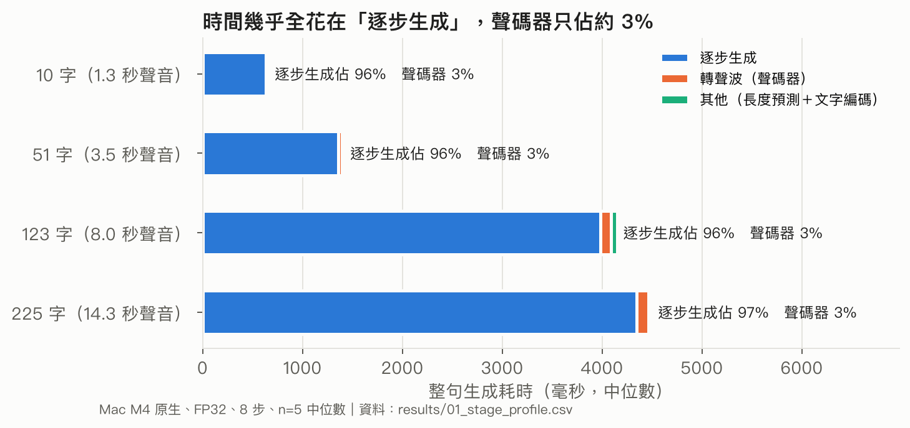
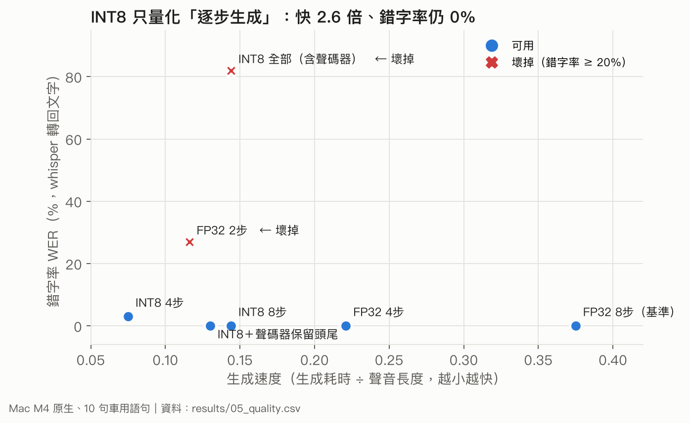
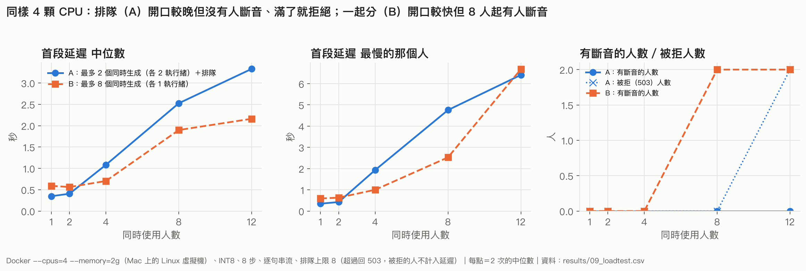

# Streaming TTS Deployment Demo

把一個公開的語音合成模型（Supertonic-3，ONNX）從「整句生成的研究原型」做成可上線的形態：逐句串流、INT8 量化、延遲與記憶體調校、雲端容器服務與壓測，以及每次推程式碼都會自動跑的發版品質關卡。

| 產品化環節 | 這個 repo 裡的證據 |
|---|---|
| 模型整合 | `src/engine.py` 把官方整句流程拆成五個可分開計時、可替換的階段；`src/streamer.py` 接上逐句串流與環形緩衝 |
| 推論最佳化 | INT8 動態量化：逐步生成快 2.6～3.3 倍；逐層定位出聲碼器不能量化的輸出頭；換硬體加速器（CoreML）：固定輸入長度後快 3.3 倍，比較後不採用（見結果 5） |
| 延遲與記憶體調校 | 首段延遲 2.45 → 0.90 s（逐句）；記憶體 495 → 353 MB；預填量、步數、執行緒的取捨；冷啟動 0.2 s；推論引擎記憶體設定再省 7% |
| 嵌入式／雲端部署 | 雲端：`service/` 容器化串流 API＋排隊上限＋過載拒絕，壓測 1～24 人；嵌入式：只做到 CPU 配額模擬（見範圍說明） |
| 發版品質把關 | `scripts/release_gate.py`＋GitHub Actions：錯字率、音色偏離、速度、記憶體、首段延遲、斷音，任一不過就擋下 |

**範圍說明（先講清楚）**
- 模型不是自己訓練的，用的是官方預訓練權重；本專案做的是**部署端**：拆流程、串流、量化、量測。
- 全部在 Mac（Apple M4，CPU）上跑，**沒有 NVIDIA 顯卡，沒有做 TensorRT**。
- 「資源受限」是用 Docker 的 CPU 配額（`--cpus=1`）模擬的，跑在 Mac 上的 Linux 虛擬機裡，**不等於真實車用晶片**，只拿來看趨勢。
- 每組樣本數不大（n=5～12），數字當趨勢看，不當規格。

---

## 架構

```
文字 ──切段（逐句）──▶ 推論執行緒 ──寫入（滿了就等，不丟音）──▶ 環形緩衝 ──▶ 播放回呼（固定節拍）
                        │                                              │
                        └ 每句：長度預測 → 文字編碼 → 逐步生成 ×N → 聲碼器    └ 資料不足：立刻補靜音、記一次斷音（不等待）
```

- `src/engine.py`：把官方整句流程拆成可分開計時的五個階段，可替換任一個 ONNX（量化版）。
- `src/ringbuffer.py`：固定容量環形緩衝。寫端背壓（車用不能丟音）；讀端永不阻塞（音效卡回呼被卡住會爆音）。Python 版用一把鎖；產品版應改 C/C++ 無鎖單生產者單消費者結構。
- `src/streamer.py`：切段策略、預填量、斷音判定、水位記錄；播放端可選「模擬音效卡節拍」（量測用）或真實喇叭（demo 用）。

## Demo 網頁與影片

▶ [demo 影片 results/video/streaming_tts_demo.mp4](results/video/streaming_tts_demo.mp4)（74 秒）：FP32 同一段文字「整句做完才播 vs 逐句串流」對照（開口 3.46 s vs 1.66 s），接著 INT8 逐句串流並中途暫停 3.5 秒（開口 1.05 s，0 斷音，緩衝在暫停時被填滿）。錄影時 Chrome 同時在錄畫面，所以秒數比下方基準測試慢一些。

網頁可以：自選模式／模型／步數、對照「整句 vs 逐句」、**暫停／繼續**（暫停時生成照跑，緩衝會被填滿到上限＝畫面上直接看得到背壓；暫停時間不算斷音）、**停止**；每次播放顯示首段延遲、斷音、生成速度與峰值記憶體（記憶體取實驗 8 的獨立行程實測值，因為網頁伺服器同時載入兩套模型，無法現場分開量）。

網頁下方另有「其他實驗」區：冷啟動與記憶體設定、CoreML 直接換、固定輸入長度三張表，讀 `results/` 的結果檔（實驗 10～12，事先量好、不是現場跑；在別台電腦重跑腳本就會顯示那台的數字）；其中「現場量一次冷啟動」按鈕會當場開新行程從零載入並合成第一句。

- **聲音是那一次真正播出去的聲音**：播放核心把每個送給喇叭的區塊連同時間戳記下來，再依畫面上「綠色播放條第一次出現」的那一格自動對齊（`ui/mux_video.py`），不是事後配音。
- **畫面上每個點都是同一次播放回報的事件**：每段生成開始／完成、開口、斷音、緩衝水位（每 50 ms）。

```bash
.venv/bin/python ui/server.py                 # 開 http://127.0.0.1:8765，聲音從本機喇叭出
.venv/bin/python ui/server.py --silent        # 不出聲（模擬音效卡節拍）
PW=<playwright 模組路徑> node ui/record_demo.cjs   # 自動操作網頁並錄成 results/video/streaming_tts_demo.mp4
```

## 為什麼是「逐句」串流，不是逐格

一開始的規劃是「前段整句算、只把聲碼器切段」。**先量才發現行不通**（實驗 1，n=5 中位數）：

| 句長 | 聲音長度 | 逐步生成 | 聲碼器 | 其他 |
|---|---|---|---|---|
| 10 字 | 1.3 s | 636 ms（94%）| 18 ms（3%）| 8 ms |
| 123 字 | 8.0 s | 3986 ms（97%）| 107 ms（3%）| 58 ms |

時間 95% 在「逐步生成」，而它要看整句文字、不能沿時間軸切。所以切段放在句子層級：第一句做完就開播，後面的句子在播放的同時生成。

## 結果

圖全部由 `scripts/09_charts.py` 直接讀 `results/*.csv` 產生（不手填數字）：

| | |
|---|---|
|  |  |
|  |  |


### 1. 串流 vs 整句（Mac 原生，8 步，FP32，每組 n=12）

| 切段方式 | 首段延遲 中位數 / 最差 | 斷音 |
|---|---|---|
| 整句做完才播 | 2454 / 3398 ms | 0 |
| 逐句 | 900 / 1958 ms | 0 |
| 逐句，第一句再切到第一個逗號 | 682 / 847 ms | 0 |

單執行緒時三者為 3304 / 1190 / 889 ms（中位數），一樣零斷音——M4 一顆核心就跟得上播放，所以要另外用 Docker 壓低算力才看得到斷音（見 3）。
「切到第一個逗號」的語調代價還沒量。

### 2. 量化與步數：速度 × 品質（Mac 原生，10 句車用語句）

品質用兩個客觀指標，不用自己耳朵打分：
- **WER**：用 whisper（small.en）把合成語音轉回文字算錯字率（數字已正規化，`200`＝`two hundred`）。
- **頻譜差**：與「FP32、8 步、同隨機種子」輸出的 log-mel 平均差。**基準線：同設定只換隨機種子＝1.525**，低於這個就算在模型自然變化範圍內。

| 版本 | 步數 | WER | 頻譜差 | 生成速度（越小越快）| 峰值記憶體 |
|---|---|---|---|---|---|
| FP32 | 8 | 0% | 0 | 0.375× 即時 | 495 MB＊ |
| FP32 | 4 | 0% | 0.954 | 0.221× | |
| FP32 | 2 | **27%** | 2.221 | 0.116× | |
| **INT8 逐步生成** | 8 | **0%** | **0.433** | **0.144×（快 2.6 倍）** | **353 MB＊（-29%）** |
| INT8 逐步生成 | 4 | 3% | 1.016 | 0.075× | |
| INT8 全部（含聲碼器）| 8 | **82%（壞掉）** | 1.771 | 0.144× | |
| INT8 全部，聲碼器頭 1 層＋尾 3 層留 FP32 | 8 | 0% | 0.512 | 0.130× | |

模型檔：逐步生成 244 MB → 62 MB；聲碼器 96 MB → 24 MB（但見踩坑 2）。

＊峰值記憶體 11/18 量；11/19 同一台機器、同一支腳本、同套件版本重量一次是 FP32 558 MB、INT8 375 MB（`results/08_memory_1119.txt`）。絕對值差 10～15%，原因未查證；INT8 省的比例兩天一致（29%／33%）。見踩坑 10。

### 3. 資源受限（Docker `--cpus=1`，單執行緒，8 步，逐句，每組 n=8）

| 版本 | 預填量 | 首段延遲 中位數 / 最差 | 出現斷音的次數 | 斷音平均 / 最長 |
|---|---|---|---|---|
| FP32 | 0.2 s | 1545 / 3091 ms | 4/8 | 337 / 1017 ms |
| FP32 | 1.0 s | 1479 / 3163 ms | 4/8 | 442 / 1226 ms |
| FP32 | 2.0 s | 2336 / 4648 ms | 2/8 | 228 / 994 ms |
| INT8 | 0.2 s | **690 / 2189 ms** | **0/8** | 0 |
| INT8 | 1.0 s | 722 / 1350 ms | 0/8 | 0 |
| INT8 | 2.0 s | 1212 / 2165 ms | 0/8 | 0 |

**這裡的「斷音」是什麼**：因為一整句生成完才寫入，斷音只發生在**句子之間**——句間停頓被拉長，不會在字中間卡掉。

### 4. 冷啟動與「量化以外」的記憶體調校（`scripts/10_runtime_options.py`）

INT8 版本、長句（約 2 句話），每個設定開獨立行程量 3 次取中位數；模型檔已在作業系統快取（真車冷開機還要加上從快閃記憶體讀檔的時間）。

| 推論引擎設定 | 載入 | 第一句 | 之後每句 | 載入後記憶體 | 峰值記憶體 |
|---|---|---|---|---|---|
| FP32 預設（參考） | 0.28 s | 2.53 s | 2.52 s | 449 MB | 587 MB |
| **INT8 預設** | 0.20 s | 0.63 s | 0.64 s | 263 MB | 395 MB |
| 載入時不做圖優化 | 0.10 s | 0.69 s | 0.73 s（慢 14%） | 265 MB | 413 MB |
| 事先存好優化後的模型 | **0.11 s** | 0.63 s | 0.64 s | 259 MB | 400 MB |
| 關掉記憶體池（arena） | 0.19 s | 0.64 s | 0.66 s | 264 MB | 389 MB |
| **關掉記憶體配置規劃（mem pattern）** | 0.19 s | 0.64 s | 0.66 s | 264 MB | **367 MB（-7%）** |
| 兩個都關 | 0.20 s | 0.70 s | 0.65 s | 264 MB | 366 MB |

- **冷啟動不是瓶頸**：4 個模型載入共 0.2 s，第一句跟之後一樣快（沒有「第一次比較慢」的問題）。事先存優化後的模型能把載入砍半，但只省 0.1 s，不值得多一個發版產物要管。
- **圖優化值得留著**：關掉它載入快 0.1 s，但每句慢 14%、記憶體還更多。
- **記憶體配置規劃是唯一有感的開關**：關掉後峰值少 28 MB（-7%），速度差在雜訊內。原因：它會照第一次執行的形狀預先排好緩衝區，而每句話長度不同。記憶體吃緊的車機可以關。
- **連續合成 12 次，記憶體在第 2～4 次後就持平**（INT8 預設停在 396 MB、關掉配置規劃停在 367 MB），短期內沒有一直漲的跡象。

### 5. 換到硬體加速器：Apple CoreML（`scripts/11_coreml.py`、`scripts/12_static_shape.py`）

手邊沒有 NVIDIA 顯卡，但 ONNX Runtime 在 Mac 上可以把模型交給 CoreML（可用 GPU／神經網路引擎）。會遇到的問題跟 TensorRT、車用 NPU 同一類：運算支不支援、模型被切幾塊、長度不固定建不建得起來、精度、首次編譯。

**第一步：直接換（長度不固定）**

| 交給 CoreML 的部分 | 結果 |
|---|---|
| 4 個模型都用 MLProgram 格式 | **3 個建不起來**：長度不固定，推算形狀時卷積輸出「太小」 |
| 逐步生成，NeuralNetwork 格式 | 建得起來，但 1004 個運算被切成 **134 塊**（CPU 與加速器來回切換）；「全部」與「GPU」選項沒有變快 |
| 逐步生成，NeuralNetwork，指定神經網路引擎 | 長句 1.58～1.91 s → **0.83～1.14 s**（3 輪都較快，約 1.7 倍） |
| 聲碼器 | 0.04 s → 0.14～0.17 s，**變慢** |
| INT8 的逐步生成交給 CoreML | 0.43 s → 1.57 s，**變慢**（量化過的模型交給加速器反而失去優勢） |

**第二步：固定輸入長度（不足的補齊）**——把逐步生成的輸入固定成文字 128、潛在 128（涵蓋 10 句測試句最長的 102／92），每句補零、用遮罩標出補的部分，跑完再裁回。

| 設定（10 句車用語句） | 逐步生成時間（中位數） | 載入 | WER | 與原版頻譜差 |
|---|---|---|---|---|
| CPU FP32，不補齊（原版） | 0.93 s | — | 0% | 0 |
| CPU FP32，補齊 | 1.96 s（白算補的部分，慢一倍） | 0.1 s | 0% | 1.23 |
| **CoreML MLProgram，補齊** | **0.28 s（快 3.3 倍）** | **6～8 s**（首次編譯） | 0% | 1.23 |
| CPU INT8，不補齊（目前選擇） | **0.26 s**（短句 0.17 s） | 0.2 s | 0% | 0.43 |

- 固定長度後 889 個運算有 859 個交給 CoreML、只切成 29 塊，MLProgram 建起來了。
- **補齊本身就會改變輸出**（頻譜差 1.23，CPU 補齊也一樣，所以差異來自補齊而不是加速器）；仍在「只換隨機種子」的自然變化 1.525 以內、WER 0%。
- 首次編譯 7.9 s；開 CoreML 的模型快取後第二次起 **1.4 s**，但快取在硬碟上佔 **539 MB**（原模型 244 MB）。
- 「全部／神經網路引擎／GPU」三個選項速度幾乎一樣（0.28～0.31 s），而且動態長度那組「神經網路引擎」和「GPU」選項的輸出數值完全相同，**沒辦法證實實際跑在哪顆晶片上**（要用需管理員權限的系統監控工具，沒做）。

**結論：在這台 Mac 上維持 CPU INT8。** CoreML 固定長度版跟它一樣快，但短句反而較慢（長度固定 128，短句也要算滿）、開機要多 1.4～8 s、多 539 MB 快取。加速器的好處是不用量化就能保持 FP32 品質、並把 CPU 讓給車上其他程式（後者沒量）。可以帶到車用 NPU／TensorRT 的經驗：**先固定輸入長度（長短差很多時準備幾種長度）、補齊後重跑品質檢查、把首次編譯與快取算進開機時間、看模型被切成幾塊**。

## 發版品質關卡（每次推程式碼自動跑）

`scripts/release_gate.py <候選版本>`：候選版本定義在 `configs/release_candidates.json`，門檻在 `configs/gate_thresholds.json`。
**每一項都跟同一台機器上現場量的 baseline 比**，所以同一份門檻在 Mac 和 GitHub 的 x86 機器上都能用。任一項不過 → 結束碼 1 → CI 紅燈。

| 檢查 | 門檻 |
|---|---|
| 錄音辨識錯字率（whisper 轉回文字） | ≤ 5%，且比 baseline 增加 ≤ 2 個百分點 |
| 頻譜偏離（同隨機種子對 baseline） | ≤「baseline 只換隨機種子」的自然變化量 |
| 生成速度 | 不得比 baseline 慢 |
| 峰值記憶體（獨立行程） | ≤ baseline × 1.05 |
| 串流首段延遲 p50 | ≤ baseline × 1.10 |
| 串流斷音 | 0 次 |

Mac 上實測（`results/gate/*.md`）：

| 候選 | 結果 | 關鍵數字 |
|---|---|---|
| `int8_ve`（只量化逐步生成） | ✅ 准許發版 | 7 項全過，速度 3.25×，錯字率 0% |
| `int8_all`（連聲碼器一起量化） | ❌ 擋下 | 錯字率 82%（每句都被聽成 "Thank you."） |
| `fp32_s2`（只用 2 步） | ❌ 擋下 | 錯字率 27%（"Turn left." → "Or at last."） |

**兩個被擋下的版本都比較快、記憶體也比較少**——只看速度會選它們上線，是品質關卡把它們攔下來。
GitHub Actions（`.github/workflows/release-gate.yml`）同時檢查兩件事：`int8_ve` 必須通過、`int8_all` **必須被擋下**——證明關卡不是永遠綠燈。

## 雲端服務與壓測

`service/tts_service.py`（容器：`docker/Dockerfile.service`，模型以唯讀方式掛載、不打包進映像）：
- `POST /v1/tts` 逐句串流回傳 16-bit PCM（HTTP chunked），每生成完一句就送出
- `MAX_CONCURRENT`：同時最多幾個請求在生成，其餘排隊；`MAX_QUEUE`：排隊上限，超過直接回 503（卸載，保護已在服務中的人）
- `/healthz`（模型載入完成才就緒，接容器健康檢查）、`/metrics`（請求數、進行中、排隊、被拒、首段延遲 p50/p95）

壓測（`scripts/run_loadtest.sh`）：同一個容器資源（`--cpus=4 --memory=2g`），比較兩種設定；客戶端各自模擬喇叭播放，算每個人的首段延遲與斷音。



| 同時人數 | A：最多 2 個同時生成（各 2 執行緒）＋排隊 | B：最多 8 個同時生成（各 1 執行緒） |
|---|---|---|
| 1 | 首段 0.30～0.39 s | 0.52～0.66 s（每人只分到 1 條執行緒） |
| 4 | 中位數 1.1 s（最慢 1.7～2.1 s），0 人斷音 | 0.7 s（最慢 1.0 s），0 人斷音 |
| 8 | 中位數 2.4～2.6 s（最慢 4.6～4.9 s），**0 人斷音** | 1.9 s（最慢 2.5 s），**8 人中 2 人斷音**（每人最長 1.3 s） |
| 12 | **2 人被拒（503）**，其餘中位數 3.3 s、0 斷音 | 不拒絕，中位數 2.1～2.2 s，**2 人斷音**，最慢 6.6～6.8 s |
| 16 | 6 人被拒，其餘中位數 2.7～2.9 s（最慢 5.5 s）、0 斷音 | 不拒絕，中位數 **4.2～4.5 s**（最慢 8 s），**4 人斷音** |
| 24 | 12～14 人被拒，其餘中位數 3.2～3.6 s、0 斷音 | 8 人被拒，中位數 4.2～4.3 s，5 人斷音 |

（每格 2 次，兩次結果一致；系統無其他重負載下量測。同一時間 A 最多收 2＋8 人、B 最多收 8＋8 人，超過就 503。）

**機器的極限**：「每秒能生成幾秒聲音」在 4 人時就到頂（A 約 13～14、B 約 16），之後人再多總產出都停在 12～14，只是每個人分到的變少。所以 4 顆 CPU 的產能大約是**每秒生成 12～14 秒的聲音**；超過以後多收的人只會讓大家都變慢。

**能服務幾個人，取決於願意讓人等多久**（A，0 斷音前提下）：

| 體驗標準 | 可服務人數 |
|---|---|
| 最慢的人 2 秒內開口 | 約 4 人 |
| 最慢的人 5 秒內開口 | 約 8 人 |
| 更多人 | 由排隊上限決定要讓人等還是直接回忙線 |

**取捨**：B 在 12 人以內開口比較快、也比較少拒絕人，但 8 人起開始有人講到一半卡住；從 16 人起 B 連開口都比 A 慢（大家擠在一起分 CPU，每個人都變慢）。A 讓後來的人等久一點、滿了就明說「忙線」，但一旦開始講就不會斷。對語音來說，講到一半卡住比晚一點開口更糟，所以選 A；`MAX_QUEUE` 的大小＝「願意讓人等多久」。
**B 對 CPU 被搶很敏感**：同一組壓測第一次是在 Mac 背景有 Android 模擬器等程式時跑的（系統負載約 7），當時 B 在 8 人時有 **5 人**斷音、12 人時 7～8 人斷音、最慢 10.5 s；A 在同樣條件下仍然 **0 人斷音**，只是開口變慢（8 人中位數 3.4 s）。也就是 A 在資源被擠壓時是「變慢」，B 是「變卡」。
**限制**：壓測跑在 Mac 上的 Linux 虛擬機，不等於雲端主機；測到 24 人、每組 2 次。

## 踩到的坑（都是實際發生、有數字的）

1. **先規劃後量測，規劃錯了。** 原本要「只切聲碼器」，量了才知道它只佔 3%；改成逐句管線。
2. **聲碼器 INT8 量化整個壞掉**（WER 82%，whisper 只聽出 "Thank you."）。逐層定位（實驗 6）：
   | 保留為 FP32 的層 | WER |
   |---|---|
   | 無 | 82% |
   | 第 1 層 | 83% |
   | 最後 1 層 | 82% |
   | **最後 2 層（輸出頭）** | **1%** |
   | 第 1 層＋最後 2 層 | 0% |

   敏感的是輸出頭。另外 `per_channel=True` 對這個聲碼器的動態量化輸出**完全沒變**（原因未查證）。
   **決定：聲碼器維持 FP32。** 它只佔 3% 時間，量化省不了多少，風險卻最大。
3. **錯字率計分本身會騙人。** 第一版把 whisper 寫的 `200`、`20%` 都算錯，FP32 基準就有 6% 錯字率；正規化數字後歸零。
4. **步數有懸崖。** 8→4 步品質幾乎不變，4→2 步 WER 跳到 27%（"Turn left." 變 "Or at last."）。
5. **預填量在逐句串流下幫助有限。** 寫入是一次一整句，所以 0.2 s 和 1.0 s 幾乎沒差（第一句一寫進來就超過門檻）；拉到 2.0 s 斷音次數減半，但首段延遲多 0.8 s。**真正解決斷音的是讓生成變快（INT8），不是加大緩衝。**
6. **原生環境測不出問題。** M4 單核都不斷音，要用 Docker 壓 CPU 配額才看得到斷音與預填的取捨。
7. **最快的版本往往是壞的。** 發版關卡裡兩個被擋下的版本，速度和記憶體都比通過的那個好；沒有品質檢查，只看效能數字一定會選錯。
8. **量測腳本自己的 bug 會產出整批假數據。** 第一次壓測用 zsh 迴圈傳設定，`set -- $cfg` 在 zsh 不會拆字，伺服器拿到空的設定、每個請求都失敗；整批作廢，改成 bash 腳本並在每組開跑前印出容器實際設定再量。
9. **背景程式會污染量測。** 有一次錄影時 FP32 整句開口 9.27 s（正常約 2.5～3 s），查出同時有 Android 模擬器在跑；那次影片不採用。關掉模擬器前後各跑一次同樣的短測試：原生 FP32 逐句串流從 8 次中 3 次斷音、開口 1.23 s，回到 0 次斷音、0.79 s。量測前要先看系統負載，並先跑短測試對照基準。
10. **記憶體的絕對值隔天就不一樣。** 同一台機器、同一支腳本、套件版本相同，FP32 峰值 495 MB（11/18）→ 558 MB（11/19），原因未查證；INT8 省的比例兩天一致。所以發版關卡只跟「同一次、同一台」的原版比，不寫死 MB 數。
11. **加速器吃不下長度不固定的輸入，補齊又會改變結果。** MLProgram 4 個模型有 3 個建不起來；補齊到固定長度後建起來、快 3.3 倍，但輸出跟原版不同了（頻譜差 1.23）。這次剛好仍在自然變化範圍內，換模型不保證，補齊後一定要重跑品質檢查。
12. **選了加速器不代表真的跑在那顆晶片上。** 「神經網路引擎」和「GPU」選項的輸出數值完全相同、速度也接近，實際用了哪顆晶片沒有證實。

## 沒做 / 下一步

- TensorRT（需要 NVIDIA 顯卡）、靜態量化（需校正集）、明確的 FP16 轉換；CoreML 實際用哪顆晶片、CPU 讓出多少沒有量。
- 多種固定長度（目前只做 128／128 一種，短句白算）。
- 句內更細的切段（例如逗號）對語調的代價，目前只量了延遲沒量品質。
- 長時間播放的穩定性（只測了 8～15 秒的段落）。
- 雲端：沒有部署到真正的雲端主機、沒有自動擴縮；壓測到 24 人、每組 2 次。
- 句內串流（一句還沒生成完就先播）：這個模型的逐步生成要看整句，做不到，只能換模型或改架構。
- 真實車用晶片：Docker 配額只能模擬 CPU 份量，模擬不了記憶體頻寬、NPU、DMA 等硬體差異。

## 重現

```bash
uv venv -p 3.12 .venv && uv pip install -p .venv/bin/python -r requirements.txt
.venv/bin/hf download Supertone/supertonic-3 --include 'onnx/*' --include 'voice_styles/*' --include LICENSE --local-dir models/supertonic-3
.venv/bin/python -m pytest -q tests                 # 環形緩衝測試
.venv/bin/python scripts/01_stage_profile.py        # 各階段耗時
.venv/bin/python scripts/03_streaming_bench.py      # 串流 vs 整句
.venv/bin/python scripts/04_quantize.py             # INT8
.venv/bin/python scripts/05_quality.py              # WER / 頻譜差
.venv/bin/python scripts/06_vocoder_sensitivity.py  # 聲碼器逐層定位
docker build -t stts-bench docker && docker run --rm --cpus=1 -v "$PWD":/work stts-bench \
  python scripts/03_streaming_bench.py --threads 1 --steps 8 --policies sentence --prefills 0.2 1.0 2.0 --variant int8ve
.venv/bin/python scripts/demo_live.py               # 真實播放＋水位顯示
.venv/bin/python scripts/release_gate.py int8_ve    # 發版關卡（int8_all / fp32_s2 會被擋下）
docker build -f docker/Dockerfile.service -t stts-service . && bash scripts/run_loadtest.sh   # 雲端服務壓測
.venv/bin/python scripts/10_runtime_options.py      # 冷啟動、記憶體設定
.venv/bin/python scripts/11_coreml.py               # CoreML（長度不固定）
.venv/bin/python scripts/12_static_shape.py         # CoreML（補齊到固定長度）
.venv/bin/python scripts/09_charts.py               # 重畫所有圖
```

## 授權

- 模型權重：Supertone Inc.，OpenRAIL-M（`models/supertonic-3/LICENSE`，含使用限制條款）。
- `third_party/supertonic_helper.py`：Supertone Inc.，MIT（`third_party/SUPERTONIC_CODE_LICENSE`）。
