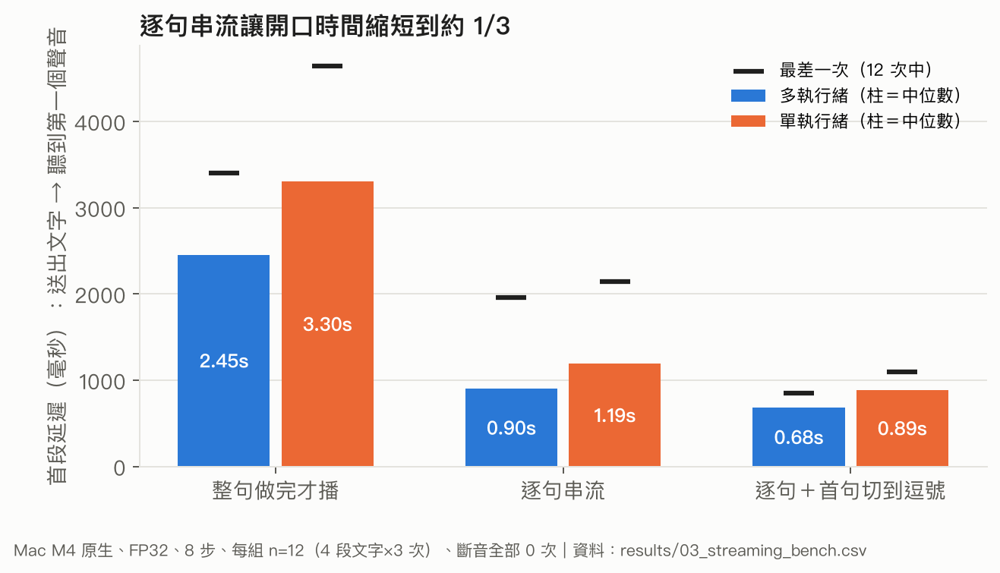
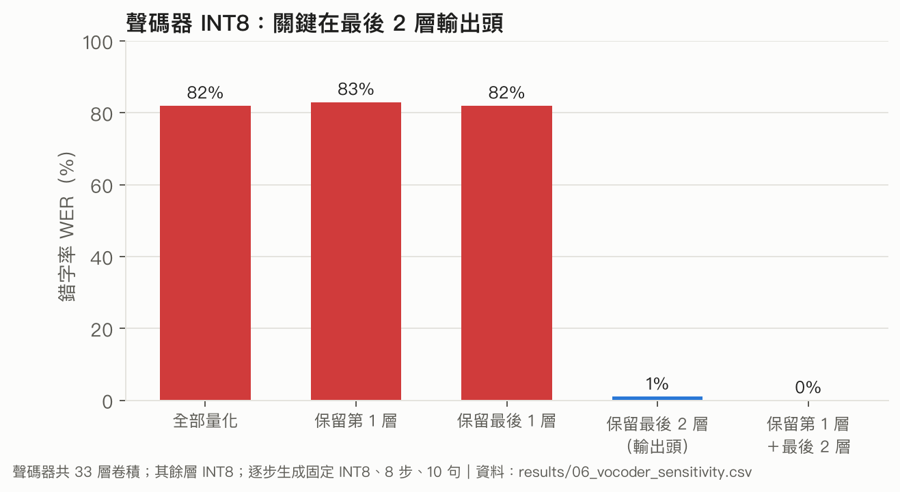
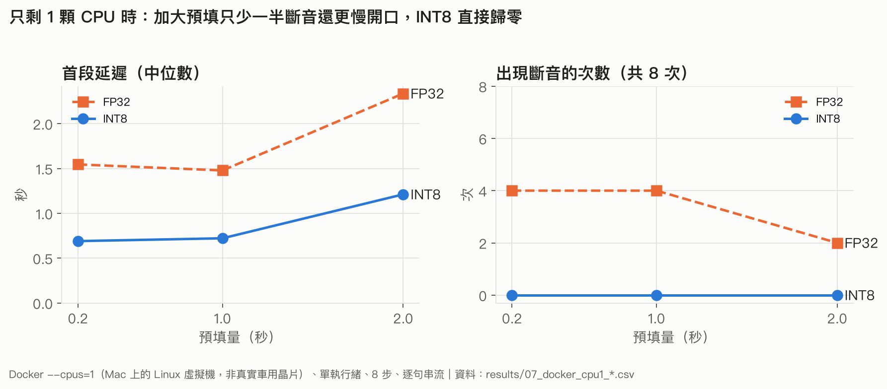

# Streaming TTS Deployment Demo

把一個公開的語音合成模型（Supertonic-3，ONNX）做成「邊生成邊播放」的串流服務，並在 CPU 上做 INT8 量化、資源受限測試、客觀品質把關。

**範圍說明（先講清楚）**
- 模型不是自己訓練的，用的是官方預訓練權重；本專案做的是**部署端**：拆流程、串流、量化、量測。
- 全部在 Mac（Apple M4，CPU）上跑，**沒有 NVIDIA 顯卡，沒有做 TensorRT**。
- 「資源受限」是用 Docker 的 CPU 配額（`--cpus=1`）模擬的，跑在 Mac 上的 Linux 虛擬機裡，**不等於真實車用晶片**，只拿來看趨勢。
- 每組樣本數不大（n=5～12），數字當趨勢看，不當規格。

---

## 架構

```
文字 ──切段（逐句）──▶ 推論執行緒 ──寫入（滿了就等，不丟音）──▶ 環形緩衝 ──▶ 播放回呼（固定節拍）
                        │                                              │
                        └ 每句：長度預測 → 文字編碼 → 逐步生成 ×N → 聲碼器    └ 資料不足：立刻補靜音、記一次斷音（不等待）
```

- `src/engine.py`：把官方整句流程拆成可分開計時的五個階段，可替換任一個 ONNX（量化版）。
- `src/ringbuffer.py`：固定容量環形緩衝。寫端背壓（車用不能丟音）；讀端永不阻塞（音效卡回呼被卡住會爆音）。Python 版用一把鎖；產品版應改 C/C++ 無鎖單生產者單消費者結構。
- `src/streamer.py`：切段策略、預填量、斷音判定、水位記錄；播放端可選「模擬音效卡節拍」（量測用）或真實喇叭（demo 用）。

## 為什麼是「逐句」串流，不是逐格

一開始的規劃是「前段整句算、只把聲碼器切段」。**先量才發現行不通**（實驗 1，n=5 中位數）：

| 句長 | 聲音長度 | 逐步生成 | 聲碼器 | 其他 |
|---|---|---|---|---|
| 10 字 | 1.3 s | 636 ms（94%）| 18 ms（3%）| 8 ms |
| 123 字 | 8.0 s | 3986 ms（97%）| 107 ms（3%）| 58 ms |

時間 95% 在「逐步生成」，而它要看整句文字、不能沿時間軸切。所以切段放在句子層級：第一句做完就開播，後面的句子在播放的同時生成。

## 結果

圖全部由 `scripts/09_charts.py` 直接讀 `results/*.csv` 產生（不手填數字）：

| | |
|---|---|
|  |  |
|  |  |



### 1. 串流 vs 整句（Mac 原生，8 步，FP32，每組 n=12）

| 切段方式 | 首段延遲 中位數 / 最差 | 斷音 |
|---|---|---|
| 整句做完才播 | 2454 / 3398 ms | 0 |
| 逐句 | 900 / 1958 ms | 0 |
| 逐句，第一句再切到第一個逗號 | 682 / 847 ms | 0 |

單執行緒時三者為 3304 / 1190 / 889 ms（中位數），一樣零斷音——M4 一顆核心就跟得上播放，所以要另外用 Docker 壓低算力才看得到斷音（見 3）。
「切到第一個逗號」的語調代價還沒量。

### 2. 量化與步數：速度 × 品質（Mac 原生，10 句車用語句）

品質用兩個客觀指標，不用自己耳朵打分：
- **WER**：用 whisper（small.en）把合成語音轉回文字算錯字率（數字已正規化，`200`＝`two hundred`）。
- **頻譜差**：與「FP32、8 步、同隨機種子」輸出的 log-mel 平均差。**基準線：同設定只換隨機種子＝1.525**，低於這個就算在模型自然變化範圍內。

| 版本 | 步數 | WER | 頻譜差 | 生成速度（越小越快）| 峰值記憶體 |
|---|---|---|---|---|---|
| FP32 | 8 | 0% | 0 | 0.375× 即時 | 495 MB |
| FP32 | 4 | 0% | 0.954 | 0.221× | |
| FP32 | 2 | **27%** | 2.221 | 0.116× | |
| **INT8 逐步生成** | 8 | **0%** | **0.433** | **0.144×（快 2.6 倍）** | **353 MB（-29%）** |
| INT8 逐步生成 | 4 | 3% | 1.016 | 0.075× | |
| INT8 全部（含聲碼器）| 8 | **82%（壞掉）** | 1.771 | 0.144× | |
| INT8 全部，聲碼器頭 1 層＋尾 3 層留 FP32 | 8 | 0% | 0.512 | 0.130× | |

模型檔：逐步生成 244 MB → 62 MB；聲碼器 96 MB → 24 MB（但見踩坑 2）。

### 3. 資源受限（Docker `--cpus=1`，單執行緒，8 步，逐句，每組 n=8）

| 版本 | 預填量 | 首段延遲 中位數 / 最差 | 出現斷音的次數 | 斷音平均 / 最長 |
|---|---|---|---|---|
| FP32 | 0.2 s | 1545 / 3091 ms | 4/8 | 337 / 1017 ms |
| FP32 | 1.0 s | 1479 / 3163 ms | 4/8 | 442 / 1226 ms |
| FP32 | 2.0 s | 2336 / 4648 ms | 2/8 | 228 / 994 ms |
| INT8 | 0.2 s | **690 / 2189 ms** | **0/8** | 0 |
| INT8 | 1.0 s | 722 / 1350 ms | 0/8 | 0 |
| INT8 | 2.0 s | 1212 / 2165 ms | 0/8 | 0 |

**這裡的「斷音」是什麼**：因為一整句生成完才寫入，斷音只發生在**句子之間**——句間停頓被拉長，不會在字中間卡掉。

## 踩到的坑（都是實際發生、有數字的）

1. **先規劃後量測，規劃錯了。** 原本要「只切聲碼器」，量了才知道它只佔 3%；改成逐句管線。
2. **聲碼器 INT8 量化整個壞掉**（WER 82%，whisper 只聽出 "Thank you."）。逐層定位（實驗 6）：
   | 保留為 FP32 的層 | WER |
   |---|---|
   | 無 | 82% |
   | 第 1 層 | 83% |
   | 最後 1 層 | 82% |
   | **最後 2 層（輸出頭）** | **1%** |
   | 第 1 層＋最後 2 層 | 0% |

   敏感的是輸出頭。另外 `per_channel=True` 對這個聲碼器的動態量化輸出**完全沒變**（原因未查證）。
   **決定：聲碼器維持 FP32。** 它只佔 3% 時間，量化省不了多少，風險卻最大。
3. **錯字率計分本身會騙人。** 第一版把 whisper 寫的 `200`、`20%` 都算錯，FP32 基準就有 6% 錯字率；正規化數字後歸零。
4. **步數有懸崖。** 8→4 步品質幾乎不變，4→2 步 WER 跳到 27%（"Turn left." 變 "Or at last."）。
5. **預填量在逐句串流下幫助有限。** 寫入是一次一整句，所以 0.2 s 和 1.0 s 幾乎沒差（第一句一寫進來就超過門檻）；拉到 2.0 s 斷音次數減半，但首段延遲多 0.8 s。**真正解決斷音的是讓生成變快（INT8），不是加大緩衝。**
6. **原生環境測不出問題。** M4 單核都不斷音，要用 Docker 壓 CPU 配額才看得到斷音與預填的取捨。

## 沒做 / 下一步

- TensorRT（需要 NVIDIA 顯卡）、靜態量化（需校正集）、FP16。
- 句內更細的切段（例如逗號）對語調的代價，目前只量了延遲沒量品質。
- 長時間播放的穩定性（只測了 8～15 秒的段落）。
- 真實車用晶片：Docker 配額只能模擬 CPU 份量，模擬不了記憶體頻寬、NPU、DMA 等硬體差異。

## 重現

```bash
uv venv -p 3.12 .venv && uv pip install -p .venv/bin/python onnxruntime numpy soundfile sounddevice huggingface_hub psutil onnx faster-whisper librosa num2words pytest
.venv/bin/hf download Supertone/supertonic-3 --include 'onnx/*' --include 'voice_styles/*' --include LICENSE --local-dir models/supertonic-3
.venv/bin/python -m pytest -q tests                 # 環形緩衝測試
.venv/bin/python scripts/01_stage_profile.py        # 各階段耗時
.venv/bin/python scripts/03_streaming_bench.py      # 串流 vs 整句
.venv/bin/python scripts/04_quantize.py             # INT8
.venv/bin/python scripts/05_quality.py              # WER / 頻譜差
.venv/bin/python scripts/06_vocoder_sensitivity.py  # 聲碼器逐層定位
docker build -t stts-bench docker && docker run --rm --cpus=1 -v "$PWD":/work stts-bench \
  python scripts/03_streaming_bench.py --threads 1 --steps 8 --policies sentence --prefills 0.2 1.0 2.0 --variant int8ve
.venv/bin/python scripts/demo_live.py               # 真實播放＋水位顯示
```

## 授權

- 模型權重：Supertone Inc.，OpenRAIL-M（`models/supertonic-3/LICENSE`，含使用限制條款）。
- `third_party/supertonic_helper.py`：Supertone Inc.，MIT（`third_party/SUPERTONIC_CODE_LICENSE`）。
